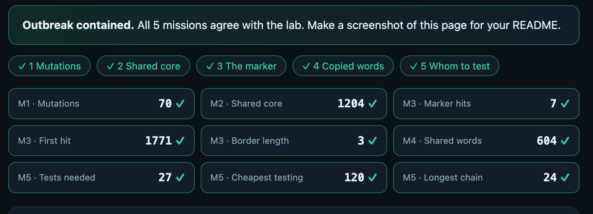

# Assignment 4. Patient Zero

Student ID: 251433
Name: Sakenov Danial
Group: SE-2540

This file is the report. Fill it in as you go. How to start: `START_HERE.md`. The task: `docs/Assignment4.pdf`.

## Program output

The 9 lines your program prints on your data (`java -cp out Main`):

    Mutations: 70
    Shared core: 1204
    Marker hits: 7
    First hit: 1771
    Border length: 3
    Shared words: 604
    Tests needed: 27
    Cheapest testing: 120
    Longest chain: 24

My outbreak report (a screenshot of `output/outbreak.html`):

## Questions

Mission 1. What does the cell d[i][j] of your table mean, and how is it computed from other cells?
The cell d[i][j] represents the minimum number of single-letter operations (insert, delete, or replace) needed to transform the first i characters of strain A into the first j characters of strain B. It is computed as the minimum of three neighboring cells: d[i-1][j] + 1 (deletion), d[i][j-1] + 1 (insertion), and d[i-1][j-1] + cost (match/replacement, where cost is 0 if A[i-1] == B[j-1] and 1 otherwise).

Mission 2. How is the longest common subsequence different from the longest common substring? My Shared core is bigger than the number of letters that are the same at the same place: why?
A longest common substring must consist of contiguous characters with no gaps, whereas a longest common subsequence (LCS) allows gaps as long as the relative order of characters is preserved. My Shared core (LCS) is larger than the number of positional matches because insertions or deletions shift the remaining characters, so matching letters still align in order even if they are at different indices.

Mission 3. What does the prefix function tell you, and why does the pointer in the text never go back in KMP? What is the Border length of my marker and what does it mean?
The prefix function pi[i] tells us the length of the longest proper prefix of p[0..i] that is also a suffix of p[0..i]. In KMP, the text pointer never moves backward because whenever a mismatch occurs, pi[k-1] tells us how many characters of the pattern already match the current suffix of the text.

Mission 4. Why must you compare the letters after the hashes are equal? What happens to the cost of Rabin-Karp if many windows have the same hash?
We must compare the actual letters because two different strings can produce the same hash value (a hash collision). If many windows share the same hash—for example, when using a small modulus—the algorithm has to perform a character-by-character comparison of length k on every collision, which degrades the total time complexity from O(n) toward O(n * k).

Mission 5. What are the two states of a person in your DP, and how do you get the answer for a person from its children? Why does a greedy "test the person with most links first" not always give the cheapest answer?
The two states for each person v are take[v] (the minimum cost for v's subtree when v is tested) and skip[v] (the minimum cost when v is not tested). We compute take[v] = cost[v] + sum(min(take[u], skip[u])) over all children u, and skip[v] = sum(take[u]) because if v is skipped, every child must be tested to cover the links. A greedy approach like "test the person with the most links" fails because it ignores individual testing costs—testing one expensive hub might cost more than testing several cheap neighbors.
## AI use

AI useI used Gemini to explain the algorithmic concepts, help structure the Java implementations for the five missions, and draft the explanations in this README.

## Timing (Mission 7)

Milliseconds, average of 3 runs, from `java -cp out Bench`.

| test | size | time |
|---|---|---|
| naive search | 20 000 / 40 000 / 80 000 |18.7 ms / 44.7 ms / 91.5 ms|
| KMP | 20 000 / 40 000 / 80 000 |1.3 ms / 0.5 ms / 0.2 ms|
| edit distance | 500 / 1000 / 2000 / 4000 |3.6 ms / 6.5 ms / 7.6 ms / 27.2 ms|

What do the numbers say about how the time grows? When you double the size, by how much does each time grow? Two or three sentences.

## Complexity

n is the length of the text (or of a strain), m the length of the pattern, k the length of the window, v the number of people. Fill in every algorithm you wrote.

| algorithm | time | space | assumptions |
|---|---|---|---|
| Edit distance |O(n * m)|O(n * m)| Using a full 2D DP table for two strains of lengths n and m.|
| LCS |O(n * m)|O(n * m)| Using a full 2D DP table for two strains of lengths n and m.|
| Prefix function and KMP |O(n + m)|O(m)|pi array takes O(m) space; text pointer never moves backward.|
| Rabin-Karp (shared words) |O(n + m) average,O(n * k)worst|O(m)| Stores hashes of B in a HashMap; worst case occurs if all hashes collide.|
| Tree DP |O(v)|O(v)|Tree has v vertices and v - 1 edges; visited once via DFS.|

## Before you submit

- The four files in `data` and the screenshot `output/outbreak.png` are in the repository.
- `java tools/Check.java` shows all examples right.
- This README is filled in, the program output and the section AI use included.
- The work is pushed to main (at least one commit per mission) and the repository is public.
- The link is attached in Moodle.
